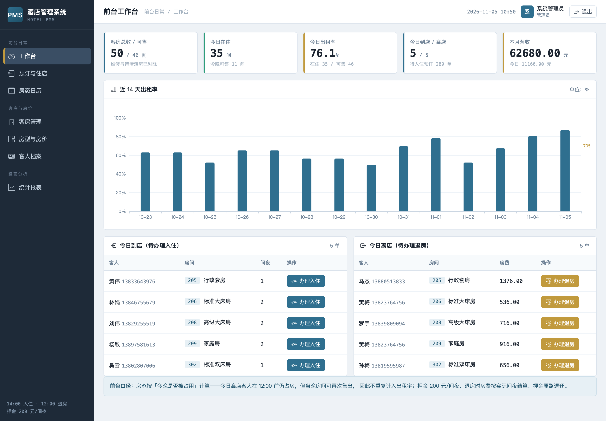
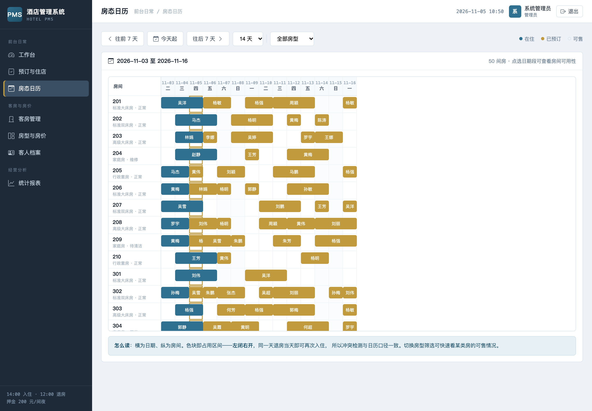
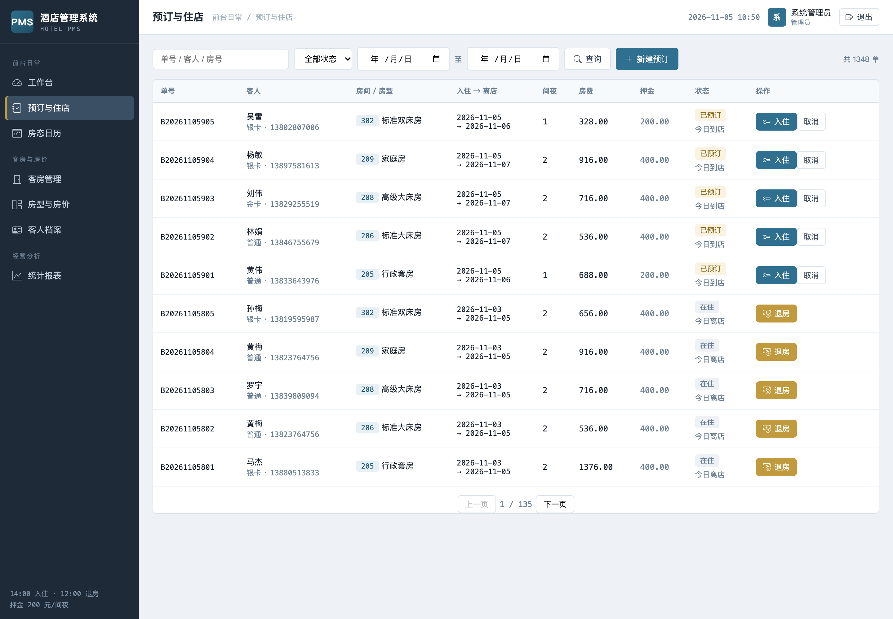
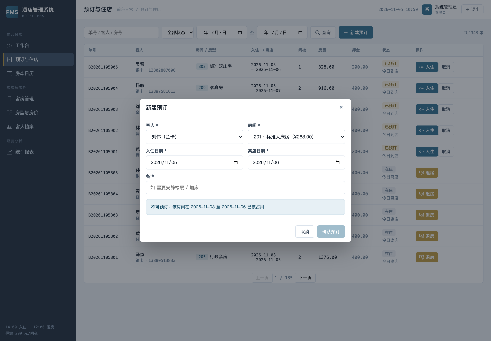
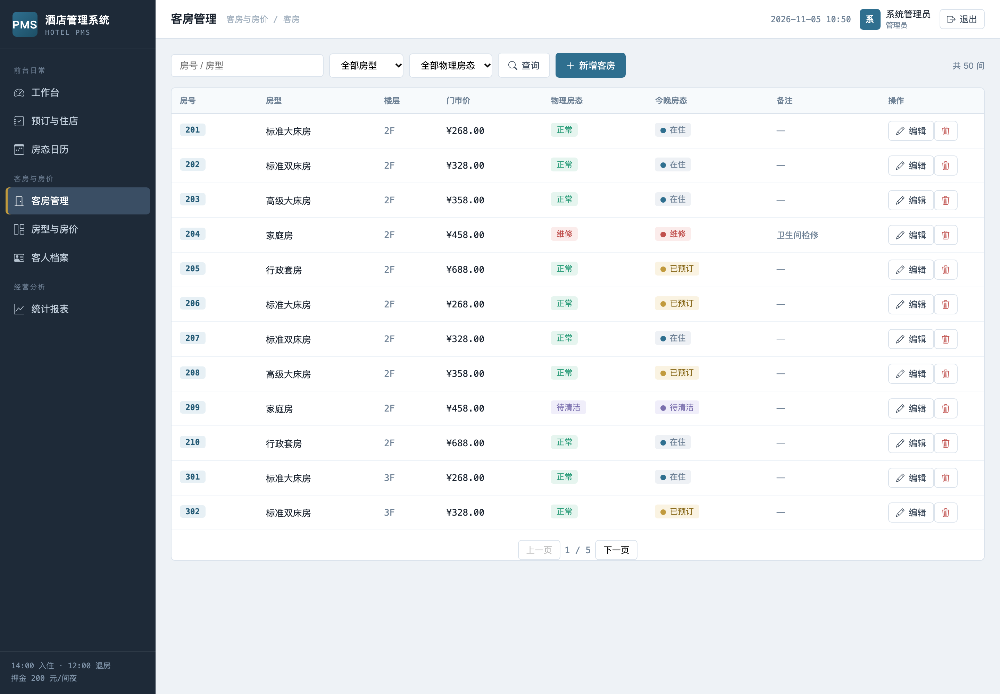
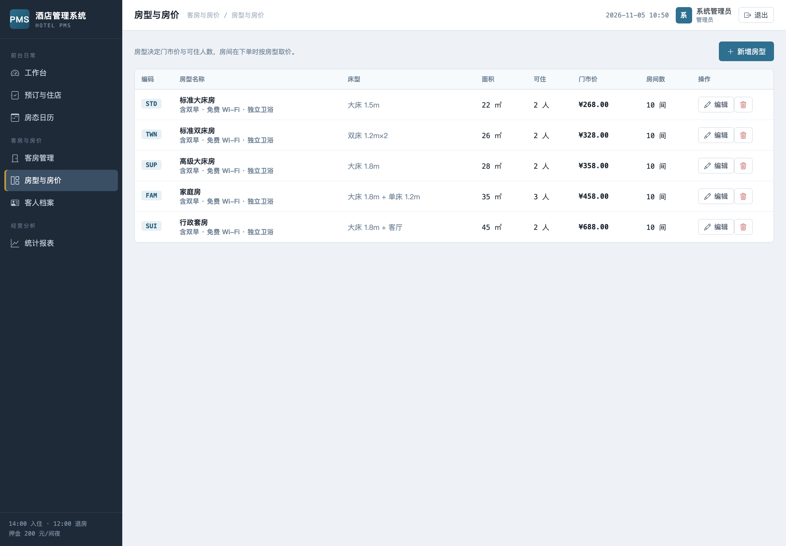
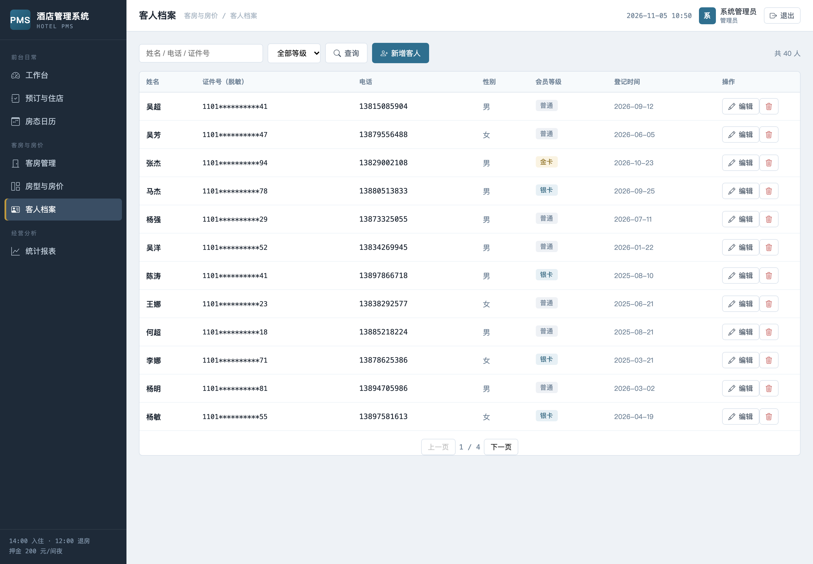
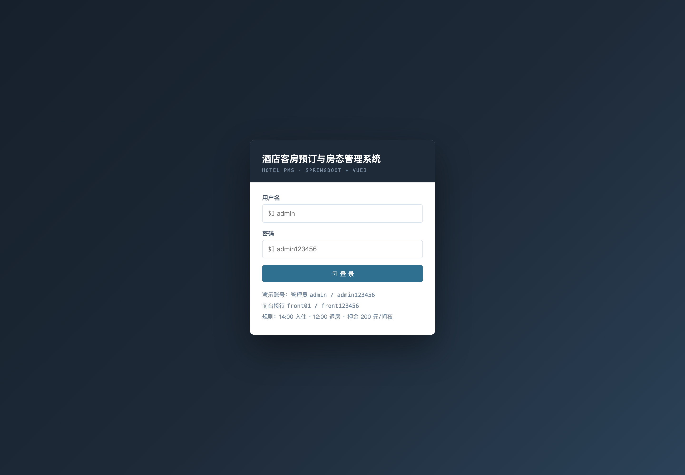

# 014 基于 SpringBoot 的酒店客房预订与房态管理系统-设计展示

> **代码有偿获取 可接受定制 微信联系方式: csbysj2020 或 ACE2487，备注(BS)**

> **完整源码与全套文档 · 在线自助获取 >>> [https://mbd.pub/o/bread/YZaWlZZpZg==](https://mbd.pub/o/bread/YZaWlZZpZg==)**

> **成品页（功能介绍 / 更多选题）>>> [https://bishe.suilang.net/products/springboot-hotel-pms](https://bishe.suilang.net/products/springboot-hotel-pms)**

> 

> 

## 视频

> **点击查看 >>> [https://www.bilibili.com/video/BV1wWxZ6PEi1/](https://www.bilibili.com/video/BV1wWxZ6PEi1/)**

## 项目简介

面向酒店前台的客房预订与房态管理系统：房型房价、客房与房态、预订登记、办理入住、退房结算、房态日历与经营统计。核心是「同一房间的有效占用区间不能相交」——占用区间取左闭右开 [入住日, 离店日)，用一条 JPQL 在事务内做相交检测，从源头杜绝超售。后端 Spring Boot 3 + JPA 分层架构，前端 Vue 3 无需构建，默认 H2 文件库免安装、可一键切换 MySQL。

客房是酒店的核心商品，具有不可储存与时间独占两个属性，这使前台日常业务本质上是「把房间按时间区间分配给客人」的调度问题。

人工排房在高入住率下容易出现超售与房态不同步。

针对这些问题，本项目设计并实现了一套基于 SpringBoot 的酒店客房预订与房态管理系统，把「房型与房价—客房—预订—入住—退房结算」串成业务闭环。

本仓库为**设计展示**：包含项目说明、技术架构、实验结果与运行截图；完整源码、任务书、开题报告、毕业论文与使用说明可通过上方链接自助获取，成品页可查看更多选题，也可联系微信咨询定制。

## 功能特性

1. 区间重叠检测防超售：占用区间左闭右开 [入住日, 离店日)，相交条件 c1<t2 且 c2>t1，一条 JPQL 在事务内先查后写

2. 房态日历：CSS Grid 渲染「日期 × 房间」网格，占用段跨列显示（蓝=在住、金=已预订），支持翻页与房型筛选

3. 退房结算：按实际间夜计算房费、押金原路退还、超住补收差额，结算说明写入单据备注

4. 房态口径两层：物理房态（正常/维修/待清洁）优先于预订；出租率以「今晚是否被占用」为准，今日离店不重复计入

5. 预订状态机：已预订 → 在住 → 已退房；可取消 / 标记未到；维修房不可预订、单次最长 30 间夜

6. 前台工作台：客房总数/可售、今日在住、出租率、到店离店与本月营收，今日清单可就地办理入住/退房

7. 双数据库：MySQL 8.0 为部署口径，交付默认 H2 文件库（免安装），--spring.profiles.active=mysql 一键切换

8. 七个业务页面 + 无构建前端：本地 Vue 3 全局构建，改完刷新即生效；HttpSession + 拦截器登录

## 技术架构

| 项目 | 说明 |
| --- | --- |
| 编程语言 | Java 17（编译目标；JDK 20 运行正常） |
| 后端框架 | Spring Boot 3.2.5 + Spring Data JPA / Hibernate |
| 参数校验 | Jakarta Bean Validation |
| 构建工具 | Maven 3.6+（附 Maven Wrapper，无需预装） |
| 前端 | Vue 3（本地 vue.global.prod.js，无需 Node 构建）+ Bootstrap Icons + ECharts 5 |
| 数据库 | MySQL 8.0（交付默认 H2 文件库，免安装，可一键切换） |
| 会话与安全 | HttpSession + 自定义 AuthInterceptor；口令 SHA-256 加盐摘要 |
| 操作系统 | Windows / macOS / Linux |
| 启动方式 | 双击一键脚本，或 java -jar hotel-system.jar（端口 8081） |

## 目录结构

以下为完整交付版的结构（本仓库仅作设计展示）：

```
springboot-hotel-pms/
├── 任务书/
│   └── 毕业设计任务书.docx
├── 开题报告/
│   └── 毕业设计开题报告.docx
├── 最终论文/
│   ├── 图/
│   │   ├── 图3-1_系统用例图.png
│   │   ├── 图4-1_系统架构图.png
│   │   ├── 图4-2_功能模块图.png
│   │   ├── 图4-3_预订与房态流程图.png
│   │   └── 图4-4_数据库ER图.png
│   └── 基于SpringBoot的酒店客房预订与房态管理系统设计.docx
├── 源码/
│   ├── .mvn/
│   │   └── wrapper/
│   ├── data/
│   │   └── hotel.mv.db
│   ├── src/
│   │   └── main/
│   ├── mvnw
│   ├── mvnw.cmd
│   ├── pom.xml
│   ├── README.md
│   ├── settings.xml
│   ├── 启动系统.bat
│   └── 启动系统.command
├── 演示截图/
│   ├── 014-01-login.png
│   ├── 014-02-dashboard.png
│   ├── 014-03-calendar.png
│   ├── 014-04-bookings.png
│   ├── 014-05-booking-new.png
│   ├── 014-06-booking-conflict.png
│   ├── 014-07-rooms.png
│   ├── 014-08-roomtypes.png
│   ├── 014-09-guests.png
│   └── 014-10-stats.png
├── 交付清单.md
├── 系统使用与二次开发说明.docx
└── 系统使用与二次开发说明.md
```

## 数据与实验结论

- 后端采用 Spring Boot 3.2.5 与 Spring Data JPA，按 Controller / Service / Repository / Entity 四层组织，统一响应 `{code, message, data}` 并由全局异常处理把业务错误转成可读提示；登录采用 HttpSession + 自定义拦截器。
- 数据库以 MySQL 8.0 为部署口径，交付默认 H2 文件库并可一键切换。
- 房态口径以「今晚是否被占用」为准：今日离店客人在 12:00 前占房，但当晚房间可再次售出，故不重复计入出租率；物理房态（维修 / 待清洁）优先于预订状态。
- 系统演示数据为 5 种房型、50 间客房、40 位客人、1348 条预订/住店单据，今日出租率 76.1%。

## 交付内容

1. 完整源码（已跑通，Spring Boot 工程 + 七个前端页面 + 前端资源）
2. Maven Wrapper 与一键启动脚本（Windows / macOS；缺 jar 时自动构建，首次联网下载依赖）
3. H2 演示数据库（5 种房型 / 50 间客房 / 40 位客人 / 约 1348 条预订住店单据）与 MySQL 配置
4. 毕业设计任务书（Word）
5. 开题报告（Word）
6. 毕业论文（Word，七章制，含区间重叠检测算法与系统测试用例）
7. 系统使用与二次开发说明（Word + md）
8. 10 张系统运行截图

## 常见问题

**项目能直接跑起来吗？**

能。交付包内带 H2 演示数据库与 Maven Wrapper，安装 JDK 17+ 后双击一键脚本会自动构建并启动（端口 8081），首次启动自动建表并写入演示数据。

**怎么防止同一间房被重复预订？**

系统把「房间被占用」建模为时间区间 [入住日, 离店日)（左闭右开），下单时用一条 JPQL 做相交检测（已有.入住日 < 目标.离店日 且 已有.离店日 > 目标.入住日），并在数据库事务内先查后写，从源头杜绝超售。

**为什么是左闭右开？**

因为客人在离店日当天退房后，当晚房间即可再次售出。若用左闭右闭，紧邻的两个预订（如 1 号退、1 号入）会被误判为冲突，房间白白空置一晚。

**今日离店的房间算出租率吗？**

不算。房态以「今晚是否被占用」为准：今日离店客人在 12:00 前占房，但当晚房间可再次售出，因此不重复计入出租率，工作台、房态日历与统计三处口径一致。

**退房怎么结算？**

按实际间夜计算房费（实际间夜 × 房价），押金原路退还，超过预订天数补收差额，结算说明写入单据备注。押金默认 200 元/间夜。

**房态日历是怎么做的？**

后端一次性返回区间内每个房间的占用段，前端用 CSS Grid 渲染「日期 × 房间」网格，占用段通过 grid-column 跨列，蓝色表示在住、金色表示已预订，与冲突检测共用同一套区间语义。

## 截图











